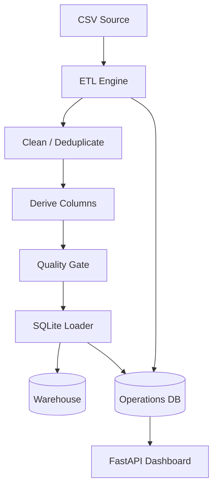

# Architecture

The warehouse database and operations database are deliberately separate. Business data belongs in the warehouse; run state, lineage, timings, row counts and failures belong in an operational metadata store.

Each task returns metadata to the engine. The engine records the task result and can stop a pipeline when a quality gate raises a failure. Load tasks also create lineage edges connecting the original source to the warehouse target.
